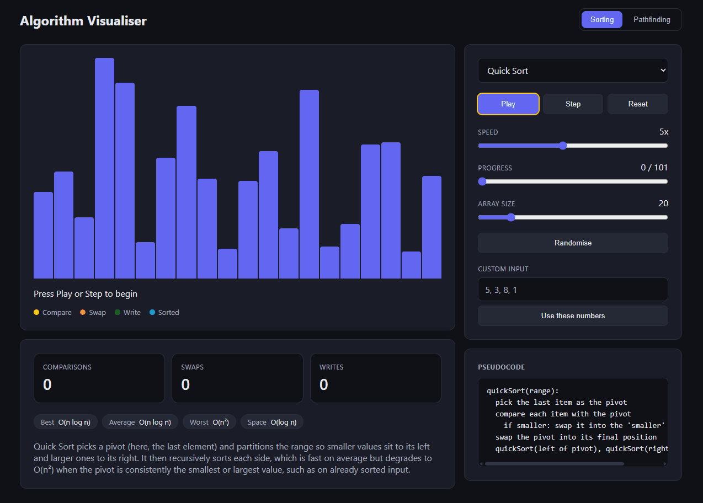
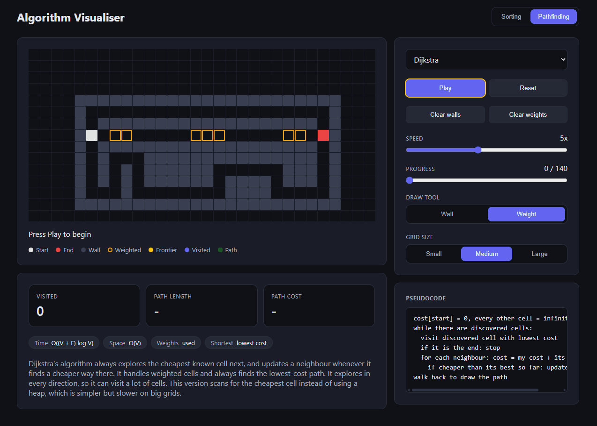

# Algorithm Visualiser

An interactive visualiser for sorting and pathfinding algorithms, built with React, TypeScript and Vite. Watch each algorithm work step by step, scrub through a run, and see live stats, explanations and highlighted pseudocode.

**Live demo:** https://algovisualiser-af.netlify.app/




## Features

### Sorting
- Bubble Sort, Insertion Sort, Merge Sort and Quick Sort
- Animated comparisons, swaps and array writes
- Random arrays (5 to 100 elements) or your own numbers (1 to 999, up to 100 values)
- Live counts of comparisons, swaps and writes, plus best, average and worst case time and space complexity
- A short explanation of each algorithm, a sentence describing the current step, and pseudocode with the current line highlighted

### Pathfinding
- BFS, Dijkstra and A* on an editable grid
- Click or drag to draw walls and weighted cells; drag the start and end cells to move them
- Works with touch as well as mouse
- Three grid sizes, with the default chosen from the screen width
- Live count of visited cells, final path length and path cost
- Complexity pills, an explanation and highlighted pseudocode for each algorithm

### Playback and interface (both modes)
- Play, pause, reset, step forward, a progress scrubber and an adjustable speed
- Dark theme, responsive layout, keyboard-focusable controls, and reduced-motion support

## Tech stack

- [React](https://react.dev) and [TypeScript](https://www.typescriptlang.org)
- [Vite](https://vite.dev)
- [Vitest](https://vitest.dev) for tests
- [oxlint](https://oxc.rs/docs/guide/usage/linter) for linting
- Plain CSS with custom properties (no UI library)

## Getting started

You need a current version of Node.js.

```bash
git clone https://github.com/andyf00/particles.git
cd algo-visualiser
npm install
npm run dev
```

Other commands:

| Command | What it does |
|---|---|
| `npm run dev` | Start the dev server |
| `npm run build` | Type-check and build for production (output in `dist/`) |
| `npm run preview` | Serve the production build locally |
| `npm test` | Run the tests in watch mode |
| `npx oxlint` | Lint the project |

## How it works

The core idea is that **algorithms never touch the UI**. Each algorithm is a pure function that takes its input and returns a list of *steps*:

```ts
bubbleSort([3, 1, 2])
// [
//   { type: "compare", indices: [0, 1], line: 2 },
//   { type: "swap",    indices: [0, 1], line: 3 },
//   ...
// ]
```

The UI then *replays* those steps. The picture on screen is a function of two things: the starting input and a step index.

```
state on screen = first N steps applied to the starting input
highlight       = step N
```

This one decision makes the rest of the app simple:

- **Playback** is just moving an index forward on a timer (`usePlayback`).
- **Scrubbing backwards** works for free, because nothing is undone: the state is recomputed from the start.
- **Stats** are derived by counting step types up to the current index, so they are always correct for any position.
- **Explanations and pseudocode highlighting** read the current step's type, indices and `line`.
- **Testing** is straightforward: replay the steps on the input and check the result, or check properties of the steps themselves.

Pathfinding uses the same pattern with a different step type (`frontier`, `visit`, `path`) and a grid instead of an array. The same `usePlayback` hook drives both modes.

### Algorithm notes

- Dijkstra and A* find the lowest-cost path. They use a simple scan to pick the cheapest cell instead of a binary heap, which keeps the code readable and is fast enough for these grid sizes, but means they run in O(V²) here rather than the textbook O((V + E) log V).
- A* uses Manhattan distance as its heuristic. This never overestimates because every cell costs at least 1, so A* still finds a cheapest path.
- BFS ignores weights, so on a weighted grid it finds the path with the fewest steps, which is not necessarily the cheapest. Running BFS and Dijkstra on the same grid shows the difference.
- Quick Sort uses the last element as the pivot, so already-sorted input is its worst case.

## Testing

```bash
npm test
```

Tests check more than final results. For example, the sorting tests also check that every step's indices are in bounds and truthful, that no-op swaps are never emitted, and that algorithms never mutate their input. The pathfinding tests check path length and cost, that A* matches Dijkstra's cost while visiting fewer cells, and that helpers return the same object when nothing changes.

## Adding an algorithm

1. Write a pure function that returns a list of steps (copy the input first, never mutate it).
2. Put it next to the other algorithms with a test file.
3. Add an entry to that mode's `registry.ts` with its complexity, description and pseudocode.
4. Set `line` on each step so the pseudocode highlight follows the run.

The registry tests fail if a step is missing a line or points past the end of the pseudocode.

## Possible future work

- A heap-based priority queue for Dijkstra and A*
- Maze generation and more pathfinding algorithms (e.g. greedy best-first search)
- More sorting algorithms
- Tests for `usePlayback`
